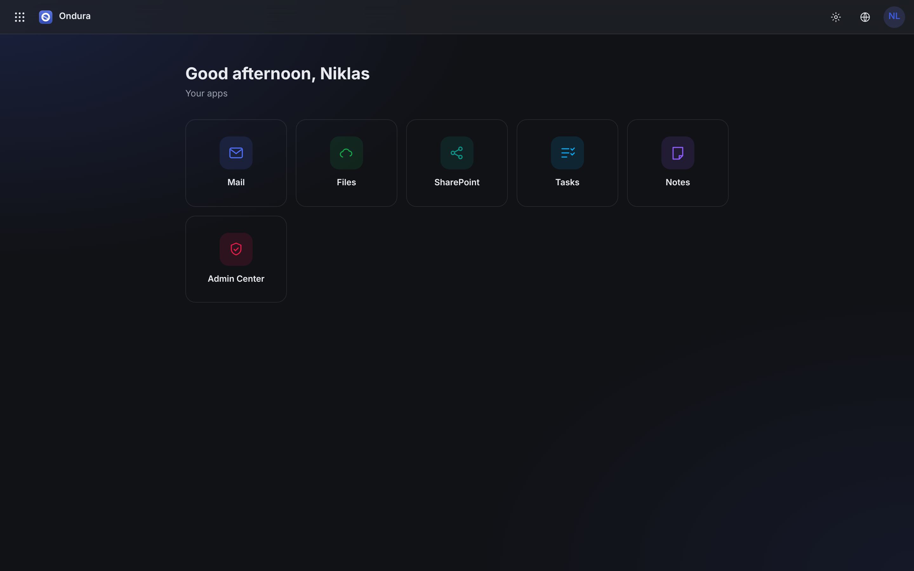
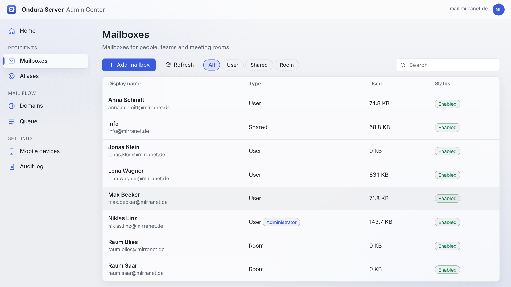

<p align="center">
  
</p>

<h1 align="center">Ondura Server</h1>

<p align="center"><b>Mail · Calendar · Contacts · Tasks</b> – one server for your domain, with Exchange ActiveSync and Exchange Web Services</p>

<p align="center"><a href="https://ondura.mirranet.de">ondura.mirranet.de</a></p>

**Ondura Server** is a complete mail server for small and medium organisations. It receives and sends e-mail for your domains and keeps calendars, contacts and tasks for every mailbox. Phones, tablets and desktop apps connect with the protocols they already speak, so people just enter their e-mail address and password:

- **Ondura Mail** on Windows, macOS and Linux
- **Outlook for iOS and Android**, the built-in mail, calendar and contacts apps of **iPhone, iPad** and **Android**
- Desktop clients with **Exchange Web Services** (EWS)
- Any other mail program via **SMTP** submission

Everything runs as one program with one database: no separate mail transfer agent, no extra calendar server, no web server in front.

## Features

**Mail**

- Receiving mail for any number of domains, aliases and catch-all addresses, plus addressing (`name+tag@`)
- Sending with automatic DKIM signatures, a delivery queue with retries and clear non-delivery reports
- SPF, DKIM and DMARC checks on incoming mail; optional spam filtering with rspamd
- Automatic replies (out of office) with separate texts for colleagues and external senders
- Forwarding, shared mailboxes with full access and send-as rights

**Calendar, contacts, tasks**

- Calendars with recurring series, changed and cancelled occurrences and reminders – series are expanded on the server, so every client shows the same dates
- Meeting invitations, replies and cancellations between mailboxes and with other mail systems (iCalendar)
- Room mailboxes that accept bookings when free and decline conflicts
- Free/busy lookups for scheduling assistants
- Contacts with all common fields, tasks and notes
- Company directory (address book of all mailboxes)

**Phones and tablets**

- Push e-mail and calendar updates
- Device overview, blocking and remote wipe
- Automatic setup through Autodiscover

**Collaboration**

- **Real-time collaborative documents**: several people signed in with their accounts edit the same text at once, with live presence, sharing per account (read-only or read-write), and conflict-free merging via Operational Transform
- A document REST API and a WebSocket for editing, so the Ondura clients can integrate it — see [Collaborative documents](docs/collab.md)

**Modular**

- Features are toggles: webmail, the Admin Center and collaboration can each be turned off. With `[collab] enabled = false` (and the HTTP toggles) Ondura runs as a pure mail server

**Webmail**

- **Webmail** in the browser at `/mail`: sign in with any mailbox and read, write and organise mail, calendar and contacts – no extra client needed, in German and English, light and dark
- Compose with attachments, reply and forward, flag, move and delete; month calendar with invitations; contact management
- Shares the same storage as ActiveSync and EWS, so changes appear everywhere at once



**Administration**

- **Admin Center** in the browser: mailboxes, aliases, permissions, domains with the DNS records to enter, DKIM keys, the delivery queue, mobile devices and an audit log – in German and English, light and dark
- Command line for scripts and quick changes
- TLS certificates (e.g. Let's Encrypt) are picked up automatically after renewal



## Download

Get the packages from the [releases page](https://github.com/Ondura-Suite/Ondura-Server/releases):

| System | File |
| --- | --- |
| Debian 12+, Ubuntu 22.04+ (x86_64) | `ondura-server_<version>-1_amd64.deb` |
| Debian 12+, Ubuntu 22.04+ (ARM64) | `ondura-server_<version>-1_arm64.deb` |
| Other Linux distributions | `ondura-server-<version>-<arch>-linux.tar.gz` |
| Container | build with the included `Dockerfile` |

## Quick start

```sh
sudo apt install ./ondura-server_<version>-1_amd64.deb
sudo nano /etc/ondura-server/config.toml          # host name, certificate
sudo ondura-server domain add example.com         # prints the DNS records
sudo ondura-server user add you@example.com --name "Your Name" --admin
sudo systemctl start ondura-server
```

Then open `https://<your host name>/admin` and sign in with the mailbox you just created. The [admin guide](docs/admin.md) walks through DNS, certificates, firewalls and client setup.

## Documentation

- [Admin guide](docs/admin.md) – installation, configuration, DNS, certificates, clients, backups
- [Webmail](docs/webmail.md) – browser access to mail, calendar and contacts at `/mail`
- [Collaborative documents](docs/collab.md) – real-time co-editing, sharing, and the client API
- [Development](docs/development.md) – architecture, protocols, building and testing
- [Security](SECURITY.md) and [fuzzing](docs/fuzzing.md)

## License

Ondura Server is free software under the [GNU Affero General Public License v3.0](LICENSE) or later. Third-party components and their licenses are listed in [THIRD-PARTY-NOTICES.txt](THIRD-PARTY-NOTICES.txt).

Exchange ActiveSync and Exchange Web Services are implemented from the protocol documentation Microsoft publishes in its Open Specifications; no Microsoft source code is used. Microsoft holds patents it actively licenses chiefly around **Exchange ActiveSync**; the EWS specifications largely fall under the Open Specifications Promise. Publishing and self-hosting this source is common practice for open-source ActiveSync servers (e.g. Z-Push) — a patent license mainly matters when you **operate the server for third parties or distribute it commercially**, and is primarily a US concern. This is not legal advice; see [Legal notes](docs/admin.md#legal-notes). Microsoft, Exchange, ActiveSync and Outlook are trademarks of the Microsoft group of companies; Ondura Server is not affiliated with or endorsed by Microsoft.
