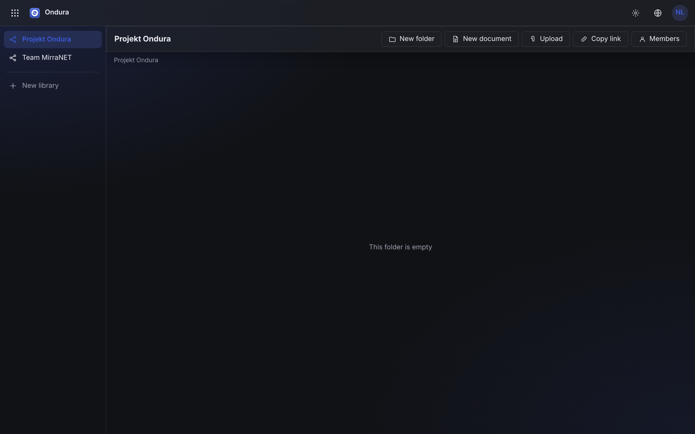

# Cloud storage

Ondura Server is more than a mail server: it also provides cloud file storage in
the style of Office 365, with personal drives (like OneDrive) and shared
libraries (like SharePoint).


 The collaborative documents live inside this
storage, so a document is an item in a drive next to ordinary files.

This is an optional module. Set `enabled = false` under `[cloud]` to turn it off
entirely, independently of mail and of the `[collab]` module; every endpoint
below then returns `404` and the **Files** area disappears from webmail.

## Model

- A **drive** is either a user's **personal drive** (created automatically, one
  per account) or a shared **library**. A library has **members**, each with a
  role: `owner`, `editor` or `viewer`. A personal drive is private to its owner.
- A drive holds **items** arranged in folders. An item is a `folder`, an
  uploaded `file`, or a `doc` — a collaborative document (see `collab.md`) that
  is edited in real time.
- Roles decide access: a `viewer` may read and download, an `editor` may also
  create, upload, rename, move and delete, and an `owner` may additionally
  manage members and the library itself. Members of a drive can open the
  documents stored in it with the same read/write level.

Uploaded file contents are stored on disk under the configured directory
(`<files_dir>/<drive_id>/<item_id>`, with previous versions under
`<files_dir>/<drive_id>/<item_id>.versions/<version_id>`); the database holds
only metadata (name, size, content type, tree position). Documents store their
text in the database like any collab document.

## Configuration

```toml
[cloud]
enabled = true
# Where uploaded file contents are stored. Defaults to <data_dir>/cloud.
# files_dir = "/var/lib/ondura/cloud"
```

## Authentication

The API lives under `/mail/api/cloud` and uses the webmail account, the same way
as the rest of the webmail API:

- **Webmail session cookie** — used automatically by the browser.
- **HTTP Basic** — for native clients.

Every mutating call must also send the header `X-Ondura-Mail: 1` (a CSRF guard),
exactly like the other webmail endpoints.

## Endpoints

Drives and libraries:

| Method | Path | Purpose |
| --- | --- | --- |
| GET | `/mail/api/cloud/drives` | List the drives the user can see (personal first, then libraries). |
| POST | `/mail/api/cloud/library` | Create a library (`{ "name": … }`). |
| POST | `/mail/api/cloud/library/rename` | Rename a library (`{ "drive", "name" }`, owner only). |
| POST | `/mail/api/cloud/library/delete` | Delete a library and its contents (`{ "drive" }`, owner only). |

Items:

| Method | Path | Purpose |
| --- | --- | --- |
| GET | `/mail/api/cloud/items?drive=&parent=` | List a folder's children (omit `parent` for the root); returns the breadcrumb, the caller's role and `canWrite`. |
| POST | `/mail/api/cloud/folder` | Create a folder (`{ "drive", "parent", "name" }`). |
| POST | `/mail/api/cloud/doc` | Create a document (`{ "drive", "parent", "name" }`); returns the item id and the collab `doc` id. |
| POST | `/mail/api/cloud/rename` | Rename an item (`{ "item", "name" }`). |
| POST | `/mail/api/cloud/move` | Move an item to another folder in the same drive (`{ "item", "parent" }`). |
| POST | `/mail/api/cloud/delete` | Move an item (and its subtree) to the recycle bin (`{ "item" }`). |
| POST | `/mail/api/cloud/upload?drive=&parent=&name=` | Upload a file; the body is the raw file content and `Content-Type` its type. Uploading over a same-name file overwrites it and keeps the previous contents as a version. |
| GET | `/mail/api/cloud/download/{item}` | Download a file (images, PDFs and text are served inline so they can be previewed). |

Sharing and browsing:

| Method | Path | Purpose |
| --- | --- | --- |
| GET | `/mail/api/cloud/recent?limit=` | The user's most recently updated files and documents across all their drives, each with the drive it lives in. |
| GET | `/mail/api/cloud/shared-with-me` | Documents shared directly with the user (not ones they own), each with its owner. |
| GET | `/mail/api/cloud/search?q=` | Search files, folders and documents by name across every drive the user can see. |
| GET | `/mail/api/cloud/links?item=` | A file or folder's share links. |
| POST | `/mail/api/cloud/link` | Create a share link (`{ "item", "write", "expires_days" }`; `expires_days` of `0` means no expiry). |
| POST | `/mail/api/cloud/link/update` | Change a link's access (`{ "token", "write", "expires_days" }`). |
| POST | `/mail/api/cloud/link/revoke` | Revoke a link (`{ "token" }`). |
| GET | `/mail/api/cloud/shared/{token}` | Public: a share link's target (file or folder), no account required. |
| GET | `/mail/api/cloud/shared/{token}/items?parent=` | Public: browse a shared folder's subtree. |
| GET | `/mail/api/cloud/shared/{token}/download?item=` | Public: download a shared file (`item` names a file inside a shared folder). |
| POST | `/mail/api/cloud/shared/{token}/upload?parent=&name=` | Public, edit links only: upload into a shared folder, or replace a shared file. |

A share link is view or edit and may carry an expiry. It opens a guest view with
no account: a single file shows an inline preview (images, PDFs, text) with a
download button, and a folder can be browsed within its own subtree. An edit link
lets the guest upload — into the shared folder (and its subfolders) or as a new
version of the shared file; guest uploads are attributed to the account that
created the link and count toward that drive's quota. A link to a trashed item,
or one past its expiry, stops resolving.

Version history:

| Method | Path | Purpose |
| --- | --- | --- |
| GET | `/mail/api/cloud/versions?item=` | A file's stored versions, newest first. |
| POST | `/mail/api/cloud/version/restore` | Restore a version (`{ "item", "version" }`); the current contents are snapshotted first, so a restore can be undone. |
| GET | `/mail/api/cloud/version/download?version=` | Download one stored version. |

A file keeps its previous contents as a version whenever it is overwritten, over
both the webmail upload and WebDAV. History is capped at the newest 50 versions
per file; version data is removed with the file when it is permanently deleted.

Recycle bin (per drive):

| Method | Path | Purpose |
| --- | --- | --- |
| GET | `/mail/api/cloud/trash?drive=` | List the drive's trashed items, most recent first. |
| POST | `/mail/api/cloud/trash/restore` | Restore an item (`{ "item" }`); orphaned items return to the drive root. |
| POST | `/mail/api/cloud/trash/delete` | Permanently delete a trashed item and its subtree (`{ "item" }`). |
| POST | `/mail/api/cloud/trash/empty` | Permanently delete everything in the drive's bin (`{ "drive" }`). |

Deleting an item is a soft delete: it moves to the drive's recycle bin and stays
out of the normal listings, but still counts toward the storage quota until the
bin is emptied, matching OneDrive and SharePoint. Deleting a library is a hard
delete of the whole library.

Members (libraries only):

| Method | Path | Purpose |
| --- | --- | --- |
| GET | `/mail/api/cloud/members?drive=` | List members and roles. |
| POST | `/mail/api/cloud/member` | Add or change a member (`{ "drive", "email", "role" }`, owner only). |
| POST | `/mail/api/cloud/member/delete` | Remove a member (`{ "drive", "user" }`, owner only). |

## Webmail

A **Files** entry appears in the webmail navigation when the module is enabled.
It shows the personal drive under **My Files**, a **Recent** list and a **Shared
with me** list of documents other people have shared directly, with folder
browsing, drag-free breadcrumb navigation, file upload and download, inline
previews for images, PDFs and text, new folders and new documents, rename, share
links, version history, a **Recycle bin** that restores or permanently removes
deleted items, a search box that finds items by name across every drive, and —
for libraries — a member manager. Opening a document hands over to the
collaborative editor described in `collab.md`.

Collaborative documents live **only** inside the cloud: they are created as items
in a drive and opened from Files, with no separate documents section.

The cloud is split into two apps with their own URLs: **Files** (`/files`, the
personal drive, OneDrive-style) and **SharePoint** (`/sharepoint`, the shared
libraries). Each library has its own link (`/sharepoint/<id>`) — the **Copy
link** button copies it — so a library can be shared or bookmarked like a
SharePoint site.



## Nextcloud clients

Each user's personal drive, and the libraries they belong to (in a `SharePoint`
folder), are reachable by the official Nextcloud mobile and desktop clients
(WebDAV, Login Flow, chunked uploads) — that is how photo auto-upload and desktop
sync work. See `nextcloud.md`.
