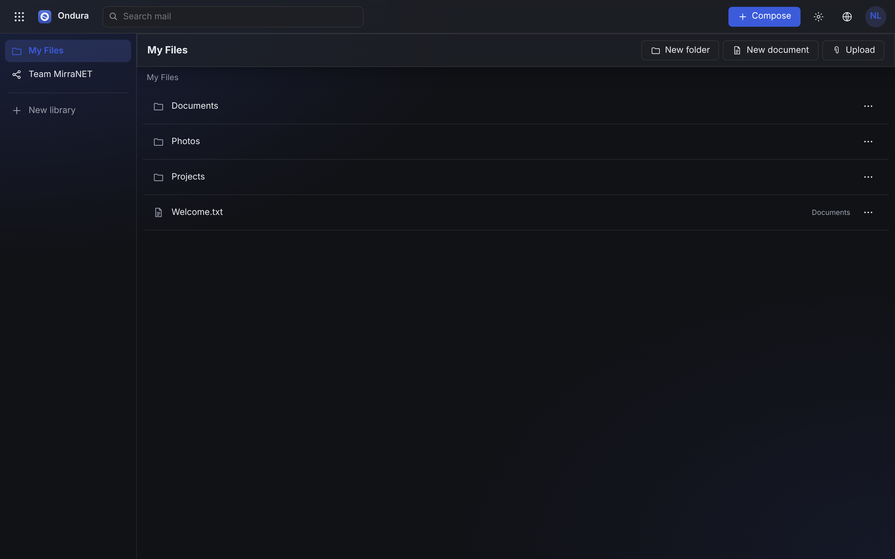

# Cloud storage

Ondura Server is more than a mail server: it also provides cloud file storage in
the style of Office 365, with personal drives (like OneDrive) and shared
libraries (like SharePoint).


 The collaborative documents live inside this
storage, so a document is an item in a drive next to ordinary files.

This is an optional module. Set `enabled = false` under `[cloud]` to turn it off
entirely, independently of mail and of the `[collab]` module; every endpoint
below then returns `404` and the **Files** area disappears from webmail.

## Model

- A **drive** is either a user's **personal drive** (created automatically, one
  per account) or a shared **library**. A library has **members**, each with a
  role: `owner`, `editor` or `viewer`. A personal drive is private to its owner.
- A drive holds **items** arranged in folders. An item is a `folder`, an
  uploaded `file`, or a `doc` — a collaborative document (see `collab.md`) that
  is edited in real time.
- Roles decide access: a `viewer` may read and download, an `editor` may also
  create, upload, rename, move and delete, and an `owner` may additionally
  manage members and the library itself. Members of a drive can open the
  documents stored in it with the same read/write level.

Uploaded file contents are stored on disk under the configured directory
(`<files_dir>/<drive_id>/<item_id>`); the database holds only metadata (name,
size, content type, tree position). Documents store their text in the database
like any collab document.

## Configuration

```toml
[cloud]
enabled = true
# Where uploaded file contents are stored. Defaults to <data_dir>/cloud.
# files_dir = "/var/lib/ondura/cloud"
```

## Authentication

The API lives under `/mail/api/cloud` and uses the webmail account, the same way
as the rest of the webmail API:

- **Webmail session cookie** — used automatically by the browser.
- **HTTP Basic** — for native clients.

Every mutating call must also send the header `X-Ondura-Mail: 1` (a CSRF guard),
exactly like the other webmail endpoints.

## Endpoints

Drives and libraries:

| Method | Path | Purpose |
| --- | --- | --- |
| GET | `/mail/api/cloud/drives` | List the drives the user can see (personal first, then libraries). |
| POST | `/mail/api/cloud/library` | Create a library (`{ "name": … }`). |
| POST | `/mail/api/cloud/library/rename` | Rename a library (`{ "drive", "name" }`, owner only). |
| POST | `/mail/api/cloud/library/delete` | Delete a library and its contents (`{ "drive" }`, owner only). |

Items:

| Method | Path | Purpose |
| --- | --- | --- |
| GET | `/mail/api/cloud/items?drive=&parent=` | List a folder's children (omit `parent` for the root); returns the breadcrumb, the caller's role and `canWrite`. |
| POST | `/mail/api/cloud/folder` | Create a folder (`{ "drive", "parent", "name" }`). |
| POST | `/mail/api/cloud/doc` | Create a document (`{ "drive", "parent", "name" }`); returns the item id and the collab `doc` id. |
| POST | `/mail/api/cloud/rename` | Rename an item (`{ "item", "name" }`). |
| POST | `/mail/api/cloud/move` | Move an item to another folder in the same drive (`{ "item", "parent" }`). |
| POST | `/mail/api/cloud/delete` | Delete an item, recursively for folders (`{ "item" }`). |
| POST | `/mail/api/cloud/upload?drive=&parent=&name=` | Upload a file; the body is the raw file content and `Content-Type` its type. |
| GET | `/mail/api/cloud/download/{item}` | Download a file. |

Members (libraries only):

| Method | Path | Purpose |
| --- | --- | --- |
| GET | `/mail/api/cloud/members?drive=` | List members and roles. |
| POST | `/mail/api/cloud/member` | Add or change a member (`{ "drive", "email", "role" }`, owner only). |
| POST | `/mail/api/cloud/member/delete` | Remove a member (`{ "drive", "user" }`, owner only). |

## Webmail

A **Files** entry appears in the webmail navigation when the module is enabled.
It shows the personal drive and any libraries as tabs, with folder browsing,
drag-free breadcrumb navigation, file upload and download, new folders and new
documents, rename and delete, and — for libraries — a member manager. Opening a
document hands over to the collaborative editor described in `collab.md`.

Collaborative documents live **only** inside the cloud now: they are created as
items in a drive and opened from Files, and there is no separate documents
section.

## Nextcloud clients

Each user's personal drive is also reachable by the official Nextcloud mobile
and desktop clients (WebDAV, Login Flow, chunked uploads), which is how photo
auto-upload works. See `nextcloud.md`.
