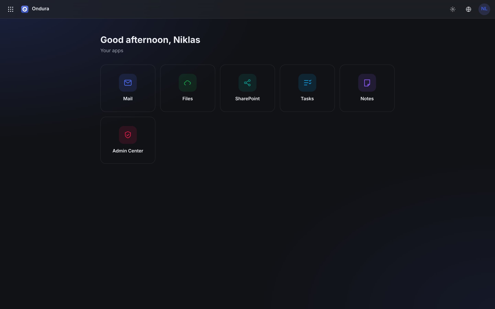

# Webmail

Ondura Server includes browser webmail at `/mail`, so a mailbox can be used
without setting up a mail program. It offers mail, calendar and contacts and
uses the same storage as ActiveSync and EWS — anything changed in webmail shows
up in connected clients and vice versa.

Signing in lands on a **home dashboard** with a tile for each app, and each app
has its own URL:

| App | URL | Contents |
| --- | --- | --- |
| Mail | `/mail` | Mail, calendar and contacts (like Outlook), switched from the app's own left navigation. Present only for accounts with a mailbox. |
| Files | `/files` | The personal drive (OneDrive-style), with a Recent list, previews, share links and version history. |
| SharePoint | `/sharepoint`, `/sharepoint/<id>`, `/sharepoint/<id>/<folder>` | Shared libraries with members, folder permissions, check-out, columns and guest links; each library and folder has its own link, so it can be shared or bookmarked. |
| Tasks | `/tasks` | Tasks. |
| Notes | `/notes` | Notes. |
| Home | `/` | The dashboard. |

Each app is its own space with its own left navigation. Switch apps from the
home tiles or the app launcher (the grid button, top left); the Ondura logo
returns to the dashboard. Admins also get an **Admin Center** tile linking to
`/admin`. The Compose button and mail search appear only inside the Mail app.

An account does not have to be a mailbox (see `admin.md`). An account without a
mailbox signs in and uses Files, SharePoint, Tasks and Notes as usual, but the
Mail, Calendar and Contacts app is not shown.



## Signing in

Open `https://<your host name>/mail` and sign in with any enabled user account
(the same address and password used for a mail client, when the account has a
mailbox). The root URL `/` redirects here. Room and shared mailboxes cannot sign
in interactively.

The interface is in German or English (switch with the globe icon) and follows
the system's light or dark appearance.

## What it does

**Mail** — folders with unread counts, message list with search across all mail
folders, reading pane, compose with attachments and signature, reply, reply all
and forward, Bcc, flag, mark read/unread, archive, move between folders, print,
and delete (to Deleted Items, then permanently). The reading pane carries a full
command bar and every message row has a right-click context menu with the same
actions. Select several messages at once to categorize, flag, archive, move,
delete or mark them read/unread in one go, and empty Deleted Items or mark a
whole folder read. Create, rename and delete your own folders. HTML messages are
shown in a sandboxed frame so message content cannot run scripts. Drafts reopen
in the composer and are kept up to date automatically while you write. A filter
bar above the list narrows it to Unread, Flagged or messages with attachments,
and a select-all box picks every message currently shown. A conversation-view
toggle in the list header groups a folder's messages into conversations by the
Message-ID / In-Reply-To / References chain (with a shared-subject fallback),
newest first, that expand and collapse; the choice is remembered. ActiveSync
derives its conversation id from the same thread root, so phones group the same
conversations.

**Attach from Files** — **From Files** in the composer opens a picker over
your personal drive and the libraries you belong to. Ticked files are either
attached as a copy (files only, up to 25 MB together) or added to the message
as view links (files and documents), the same links **Share** creates in Files.

**Send later** — the composer's **Send later** button sends the message at a
chosen time (later today, tomorrow morning, Monday morning, or any time up to a
year ahead). Waiting messages are listed under **Scheduled** in the folder list;
editing one stops it and opens it as a draft. The server sends them when due,
even with the browser closed; a message that can't be sent goes back to Drafts
with a notice. Endpoints: `POST /mail/api/send` with `"sendAt"`, `GET
/mail/api/scheduled`, `POST /mail/api/scheduled/cancel`.

**E-mail to task** — **Task** in the reading pane (or the message's context
menu) opens a new task with the subject, the sender and the start of the text,
due tomorrow; the message is flagged, and the task links back to it.

**Snooze** — **Snooze** in the reading pane (or the context menu) moves a
message to the *Snoozed* folder until a chosen time; then it returns to its
folder, unread. In the Snoozed folder the message shows when it comes back and
can be brought back at once. Endpoints: `POST /mail/api/snooze` (`{ "id",
"until" }`), `POST /mail/api/unsnooze`, `GET /mail/api/snoozed`.

**Templates** — **Templates** in the composer inserts a saved message (its
subject is used if the subject is still empty), saves the current message as a
template, or deletes templates. Endpoints: `GET /mail/api/templates`, `POST
/mail/api/template` (`{ "id"?, "name", "subject", "html" }`), `POST
/mail/api/template/delete`.

**Keyboard shortcuts** — the mail view is fully keyboard-drivable: arrow keys or
`j`/`k` move through the list, `Enter` opens, `c`/`n` compose, `r` reply,
`Shift+R` reply all, `f` forward, `e` archive, `Delete` delete, `u` toggle
read/unread, `m` move, `/` focuses search and `Esc` steps back out. Press `?`
for the full list.

**Categories** — colour-coded labels you define once and assign to messages from
the reading pane, the context menu or a multi-selection. Click a category chip
to filter the current folder to it. Manage categories (create, rename, recolour,
delete) from the account menu; deleting or renaming a category updates every
message that carried it. Category names travel with the message over EWS and
ActiveSync, so a category set in webmail also shows in Outlook and on phones.
Outlook also reads the colours: the server serves the webmail categories as the
Exchange master category list (EWS GetUserConfiguration "CategoryList"), and a
category created or recoloured in Outlook is merged back into the registry.

**Rules** — inbox rules run automatically on newly delivered mail. Each rule
matches on From, To or Subject (all or any conditions) and can move the message
to a folder, mark it read, categorize it or send it to Deleted Items, optionally
stopping further rules. Manage rules from the account menu. Because rules run on
the server at delivery, they apply to every client; Outlook can also display
them, and create or edit them over EWS (UpdateInboxRules).

**Sweep** — right-click a message and choose Sweep to act on every message from
that sender in the current folder at once: delete them all, keep only the newest,
or move them all to another folder.

**Calendar** — month, week and day views (the choice is remembered); week and
day show a time grid with overlapping events side by side, all-day events in a
strip above it and a line at the current time. Click a day number to open that
day, or an empty slot to create an event there. Drag an event to move it (in
the week view also to another day), drag its bottom edge to change its end
(both in 15-minute steps), or drag it to another day in the month view; for a
recurring event this moves only that occurrence. Only the organizer can move a
meeting. Series are expanded by the
server. Create and edit events with a description, attendees, a reminder, a
free/busy status, a private flag and a repeat pattern (daily, weekdays, weekly,
monthly, yearly, with an optional end date). Opening an occurrence of a series
asks whether to work on that occurrence or on the whole series: an occurrence can
be moved, renamed or deleted on its own, and the rest of the series stays as it
is. Accept, decline or tentatively answer meeting invitations, for one occurrence
or the whole series.

**Rooms** — room accounts (`--kind room`) show up in the event editor's
**Room** list, each marked free or booked for the chosen time. Picking one adds
it to the attendees and fills in the location; when the invitation goes out,
the room accepts it if it is free and declines it otherwise.

**Shared calendars** — **Share calendar** in the calendar's left navigation lets
other accounts on the server see when you are busy, see all details, or edit
your calendar. Calendars shared with you (and those of mailboxes you have full
access to) are listed there with a colour and a checkbox to overlay them on your
own; the choice is remembered in the browser. With free/busy access you only see
blocked time; private events stay blocks unless you may edit. With edit access
you can add and change events in that calendar — the event editor then offers
it as a target — but meetings with attendees stay read-only there, so no
invitation goes out in someone else's name. Calendar and contacts have their own
addresses (`/mail/calendar`, `/mail/contacts`).

**Reminders** — while webmail is open it checks once a minute for events whose
reminder time has come and announces each occurrence once, as a browser
notification after **Turn on reminders** in the calendar (or as a message in the
page otherwise). Declined and cancelled events are skipped.

**Subscriptions** — **Subscribe to a calendar** adds a published calendar by
its address (`https://…/…ics` or `webcal://…`), e.g. public holidays or a team
calendar from another service. The server fetches it right away and then every
hour, and it shows read-only in its own colour, with a checkbox to show or hide
it. Only addresses on the internet can be subscribed (no local or private
network addresses), files up to 5 MB, at most 20 per account. Endpoints: `GET
/mail/api/calendar/subscriptions`, `POST /mail/api/calendar/subscription`
(`{ "url", "name"? }`), `POST /mail/api/calendar/subscription/delete`, `GET
/mail/api/calendar/subscription/events?id=&from=&to=`.

**Import and export** — **Export (.ics)** downloads the whole calendar as an
iCalendar file that other calendar programs open; **Import .ics file** adds the
events of such a file to your calendar, including recurring series and changed
occurrences. Events already there (same UID) are replaced, so importing a file
twice does not duplicate them, and no invitations are sent on import. Another
person's calendar shared with you for reading can be exported with
`/mail/api/calendar/export.ics?owner=<id>`; their private events are left out
unless you may edit it.

**Contacts** — list, create, edit and delete contacts with the common fields.
The **⋯** menu imports a vCard file (`.vcf`, versions 2.1 to 4.0, several
contacts per file; cards whose address is already in the address book are
skipped) and exports all contacts as one vCard file. **Groups** are named lists
of addresses: typing a group's name in To, Cc or Bcc offers it, and picking it
adds every member; a group's page also starts a new message to all of them.
Endpoints: `GET /mail/api/contacts/export.vcf`, `POST /mail/api/contacts/import`
(`{ "vcf": "…" }`), `GET /mail/api/contact-groups`, `POST
/mail/api/contact-group` (`{ "id"?, "name", "members": [{ "name", "email" }] }`),
`POST /mail/api/contact-group/delete`.

**Directory** — the **Directory** tab in Contacts lists everyone with an
account on the server (rooms and shared mailboxes included), searchable by
name, title, department or office. A person's page shows their work details,
their manager and their direct reports, and starts a message or adds them to
your contacts. Everyone keeps their own details under **Settings → Profile**
(title, department, office, work and mobile phone, manager); administrators can
edit them in the Admin Center. Directory entries are also offered when typing
recipients. Endpoints: `GET /mail/api/directory`, `GET /mail/api/profile`,
`POST /mail/api/profile` (`{ "title", "department", "office", "phone",
"mobile", "manager" }`).

**Documents** — collaborative documents are created and opened from Files (see
`collab.md`). The editor has a formatting toolbar (headings, bold, italic,
strikethrough, code, link, lists, task lists, quote), a **Preview** that shows
the formatted document, a **Comments** pane for comments on selected text with
replies, resolve and `@user@example.com` mentions, a revision history, and a
download menu for Markdown, plain text, HTML and Word (.docx). A document has
its own address (`/files#doc=<id>`), which mention e-mails link to.

**Notifications** — the bell in the top bar collects notices about what other
people did that concerns you: a mention in a document comment, a document,
folder, library or calendar shared with you, a file submitted for your approval
and the decision on a file you submitted, a task assigned to you and the
completion of a task you assigned. Unread notices are counted on the
bell; clicking one opens what it is about. The newest 200 per account are kept.
The list is `GET /mail/api/activity` (`items`, `unread`); `POST
/mail/api/activity/read` with `{ "id": N }` marks one as read, with `{}` all.

**Notes** — a list with search on the left and the note on the right; changes
are saved as you type. Notes can be filed in **notebooks** (chips above the
list filter by notebook) and pinned to the top. A note is written in the same
Markdown dialect as documents and can be shown formatted (**Preview**). **Share
as a document** turns a note into a collaborative document in Files, where it
can be shared and edited together (the note is removed). Endpoint for that:
`POST /mail/api/note/to-document` (`{ "id" }`).

**Tasks** — a task has a due
date, an importance, a reminder (announced like event reminders while the web
app is open), a list of steps to tick off, and can repeat daily, on weekdays,
weekly, monthly or yearly: completing a repeating task starts the next one with
the next due date. A task can be **assigned** to another account on the server:
it appears in their task list (marked with who assigned it), changes to title,
due date and steps follow it there, and their progress and completion show on
the original; both sides get a notice. Deleting the original removes the copy.
Three views sit above the list: **My Day** holds the tasks picked for today
with the sun button (and suggests open tasks that are due today or overdue);
it starts empty again the next day. **All** is the full list. **Board** shows
the tasks in columns *Not started*, *In progress* and *Completed*; dragging a
card to another column sets its progress (a card moved to *In progress* gets
50 % unless it already had some). The day a task was added to My Day is stored
in the task as `my_day` (`YYYY-MM-DD`).

**Settings** (gear icon) — change your display name, directory details and
signature, see your storage (mail by folder and files, each against the quota,
with the recycle bin, older file versions and the largest files listed), set an
out-of-office auto-reply (with separate texts for internal and external
senders), change your password, turn on two-step sign-in with an
authenticator app, and manage app passwords for mail apps (see `admin.md`).
With two-step sign-in on, the sign-in page asks for the code after the
password. The storage overview is `GET /mail/api/storage`.

**Multiple addresses** — a mailbox can have several e-mail addresses
(aliases); mail to any of them arrives in the one inbox. An administrator
assigns aliases in the Admin Center or with `ondura-server alias add`. When a
mailbox has more than one address, the composer shows a **From** picker so you
can choose which address a message is sent from.

## Turning it off

Webmail is on by default. To disable it, set `webmail = false` in the `[http]`
section of the configuration and restart the service; `/mail` then returns
404 and `/` redirects to the Admin Center instead.

```toml
[http]
webmail = true   # set to false to disable browser webmail
```

## Security notes

- The session cookie is `HttpOnly`, `SameSite=Strict` and (over HTTPS)
  `Secure`, scoped to `/mail`. Mutating requests require an `X-Ondura-Mail`
  header, which blocks cross-site requests.
- Each mailbox only ever sees its own items; every lookup is checked against the
  signed-in user.
- Serve webmail over HTTPS only. Behind a TLS-terminating reverse proxy, set
  `behind_proxy = true`.

**Meetings** — adding attendees to a calendar event turns it into a meeting:
saving it sends an iCalendar invitation (iMIP `METHOD:REQUEST`) to each
attendee, an update raises the meeting's sequence so clients accept it, an
attendee taken off the list gets a cancellation, and deleting the meeting — or a
single occurrence of it — sends a cancellation, matching Outlook and ActiveSync.
The editor lists each attendee's response. Below the attendees an availability view
shows everyone's busy times for the meeting day next to the chosen slot, and
**Next free time** moves the meeting to the first weekday slot within working
hours (07:00–20:00) when everybody with known availability is free. Accounts on
the same server always share their free/busy times; event titles appear only
for calendars shared at least for reading.
Attendees accept, decline or tentatively accept from the invitation, which
sends a reply back to the organizer; incoming invitations and replies update
the calendar automatically on delivery.
